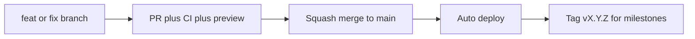

# Branching Strategy

Blinq uses **trunk-based development**. `main` is the single long-lived branch, it is always deployable, and every change reaches it through a short-lived branch and a pull request.



## `main`

- Always buildable and deployable.
- Protected: pull request required, the `CI` check must pass, linear history, no force-pushes, no direct commits.
- Merge method: **squash and merge**. The PR title becomes the commit message on `main`.

Recommended GitHub settings: *Settings > Branches > Branch protection rule* for `main` with "Require a pull request before merging", "Require status checks to pass" (select `CI`), "Require linear history", and "Do not allow bypassing".

## Branch names

Format: `<type>/<short-description>`

- Lowercase kebab-case, descriptive, ideally under 50 characters.
- No tool, personal or ticket-less prefixes. The same rule applies to everyone, including automated contributors.

| Type | Use for | Example |
| --- | --- | --- |
| `feat` | New player-facing behavior | `feat/daily-streak-badge` |
| `fix` | Bug fixes | `fix/timer-ring-low-state` |
| `refactor` | Internal change, no behavior change | `refactor/extract-stat-tile` |
| `style` | Visual or design-token changes | `style/motion-tokens` |
| `docs` | Documentation only | `docs/branching-and-design-system` |
| `chore` | Tooling, dependencies, CI | `chore/update-eslint` |
| `hotfix` | Urgent production fix | `hotfix/daily-seed-rollover` |

AI-assisted contributions follow the same rules, enforced for Cursor by `.cursor/rules/branching.mdc`.

## Workflow

1. Update `main`: `git switch main && git pull --ff-only`.
2. Branch: `git switch -c feat/short-description`.
3. Commit in small, logical steps using Conventional Commits (below).
4. Push and open a pull request into `main`. Fill in the PR template. Include light and dark screenshots for UI changes.
5. Wait for CI and review, then squash merge. Delete the branch.

Keep branches short-lived (a few days at most). Rebase on `main` rather than merging `main` into your branch.

## Commit and PR titles

[Conventional Commits](https://www.conventionalcommits.org): `type(scope): summary`

```
feat(game): add combo multiplier to scoring
fix(timer): keep ring pulsing when seconds <= 5
style(tokens): add motion duration tokens
docs: describe branching strategy
```

Common scopes: `game`, `ui`, `tokens`, `scoring`, `storage`, `daily`, `ci`.

## Unfinished work

Do not keep long-lived feature branches. Merge incomplete work behind a small flag (a constant in `src/lib`) so `main` stays releasable.

## Releases and hotfixes

- Every merge to `main` deploys automatically (Vercel production). Pull requests get preview deployments.
- Mark milestones with an annotated tag following SemVer: `git tag -a v0.2.0 -m "Daily challenge"`.
- Hotfixes use the normal flow from `main` with a `hotfix/` branch and expedited review. There are no separate release branches.

## Pull request checklist

- [ ] Branch name and PR title follow this document.
- [ ] `npm run lint` and `npm run build` pass.
- [ ] UI changes use design tokens (see [DESIGN_SYSTEM.md](./DESIGN_SYSTEM.md)) and include light and dark screenshots.
- [ ] Reduced-motion and keyboard behavior checked for new interactions.
