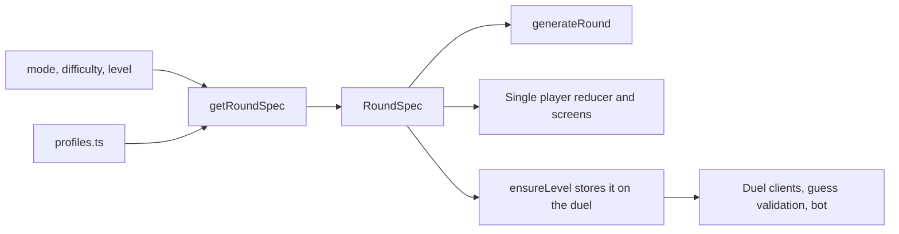

# Difficulty engine

> **Solo levels and the daily challenge** now take their numbers from `getLevelConfig` in [`src/lib/levelConfig.ts`](../src/lib/levelConfig.ts) (10-level skill blocks, one source for items, grid size, timers and lookalike share). `getRoundSpec` wraps that config into a `RoundSpec`. Duels and training still use the curves in `profiles.ts` until the multiplayer phase. Only item recall is playable so far; other round types fall back to it.

One pure module decides how every round plays: how many items are shown, how long memorize and recall last, how tricky the decoys are, how many mistakes are allowed, what a wrong pick costs, and how strong a bot is. Single player, the daily challenge, training and multiplayer duels (server, clients and bots) all read from it. To change how the game feels, change the engine; nothing else needs to move.

Code: [`src/lib/engine/`](../src/lib/engine/)

| File | Role |
| --- | --- |
| `types.ts` | The contract: `RoundInput`, `RoundSpec`, `RoundRules`, `Modifier`, `Difficulty`. |
| `profiles.ts` | The tunable curves. **This is the file you edit to retune the game.** |
| `spec.ts` | `getRoundSpec(input)`: turns a mode, difficulty and level into a `RoundSpec`, applying safety clamps. |
| `generate.ts` | `generateRound(spec, random)`: picks the targets and builds the choice grid with decoys. |
| `index.ts` | Public exports. |

## How it flows



- **Single player:** `Game.tsx` calls `getRoundSpec({ mode, difficulty: SOLO_DIFFICULTY, level })` and `generateRound`, and passes the spec to `roundReducer`. The reducer and screens read timers, lives and penalty from `round.spec`.
- **Daily:** the solo curve at `DAILY_LEVEL`, seeded by the date, so everyone gets the same table.
- **Training:** a fixed preset (`TRAINING_PRESET`).
- **Duels:** `ensureLevel` calls `getRoundSpec({ mode: "duel", difficulty: room.difficulty, level })`. It stores the item count and phase durations in their columns and the rules snapshot in `duels.rules`. Guess validation (`phases.ts`), scoring (`scoreRecall`), the duel UI (`useDuelPicks`, `DuelView`) and the bot (`makeBotPlan`) all read that stored snapshot.

## The spec

```ts
interface RoundSpec {
  engineVersion: number;
  mode: "training" | "level" | "daily" | "duel";
  difficulty: "easy" | "medium" | "hard";
  level: number;
  tier: number;           // groups of TIER_SIZE levels
  itemCount: number;      // targets on the table
  choiceCount: number;    // targets + decoys on the grid
  memorizeMs: number;
  hideMs: number;
  recallMs: number;
  lookalikeRatio: number; // share of decoys that are lookalikes of the targets
  modifiers: ("themed" | "flash")[];
  rules: { lives: number; wrongPenaltyMs: number; comboWindowMs: number };
  bot: { minRatio: number; maxRatio: number; minFinish: number; maxFinish: number };
}
```

## The curves

For each difficulty, `profiles.ts` defines:

- **Items:** a ramp (`start`, `perLevel`, `max`).
- **Memorize / recall time:** `base + perItem x items`, capped at `maxMs`, then multiplied by `decay^(level - 1)` and never going below `floor`. Once the item count stops growing, the game keeps getting harder by giving less time.
- **Choices:** `items x choiceRatio`.
- **Lookalike share:** a ramp. Higher means more decoys that look like the real items.
- **Lives and wrong-pick penalty.** Only hard duels cost time for a wrong pick (`wrongPenaltyMs`). Solo costs `SOLO_WRONG_PENALTY_MS` from `SOLO_PENALTY_FROM_LEVEL` (level 11). Easy, medium, daily and training never do.
- **Bot skill:** a recall-share ramp, its spread, and the finish window as a share of recall time.

Global settings in the same file: `SOLO_DIFFICULTY`, `DAILY_LEVEL`, `COMBO_WINDOW_MS`, `HIDE_MS`, `TIER_SIZE`, the modifier schedule and `TRAINING_PRESET` (item count and timers; training items are random each round).

### Twists (modifiers)

| Twist | When | Effect |
| --- | --- | --- |
| `themed` | From tier 2, on levels divisible by 3 | Targets come from one or two categories, so they look alike. |
| `flash` | From tier 3, on the last level of each tier | Memorize time x `FLASH_MEMORIZE_FACTOR` (0.7). |

The level label shows active twists (for example "Level 15 · Themed · Flash").

### Safety clamps (`spec.ts`)

Whatever the profiles say, a spec always has:
- at most `MAX_ITEMS` targets and `MAX_CHOICES` (20, the grid size) choices
- at least `MIN_DECOYS` (4) decoys
- memorize of at least 4s and 0.7s per item, and recall of at least 6s and 1s per item
- a bot recall share of at most 95%

Bad levels (0, negative, NaN) become level 1.

## Tuning workflow

1. Edit `src/lib/engine/profiles.ts`.
2. `npm run engine:table` prints every difficulty for levels 1 to 30 (`npm run engine:table 50` for more): items, choices, times, lookalike %, lives, penalty, bot skill and twists.
3. `npm test` checks that difficulty never drops as the level rises, that every value stays within the clamps, that generated tables are valid and deterministic, and that the rules are applied.
4. If stored rounds should be told apart (analytics, debugging), bump `ENGINE_VERSION` in `spec.ts`. Duels store it in `duels.rules.engineVersion`.

Duels that were already created keep their stored values, so retuning never changes a game in progress.

## Adding a twist

1. Add the name to `Modifier` in `types.ts`, plus its schedule in `MODIFIER_RULES` and its label in `MODIFIER_LABELS` (`profiles.ts`).
2. Apply its effect in `getRoundSpec` (numbers) or `generateRound` (which items are picked).
3. Add a test in `src/lib/engine/engine.test.ts`.

No screen or server code needs to change unless the twist adds a brand-new rule type.
