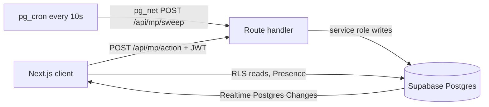

# Blinq Multiplayer (v2)

Friends play team battles in a private room. The admin creates a room, players join with a 6-character code, teams form automatically, and teams fight through one-on-one memory duels, level by level. The PRD lists real-time multiplayer as a non-goal for v1, so this is a v2 feature that lives beside single player and does not change it.

Setup: [SUPABASE_SETUP.md](SUPABASE_SETUP.md).

## Game flow

1. **Home:** Single player (the existing screen) or **Multiplayer**.
2. **Create:** name, number of levels (default 3), difficulty, pacing. The creator is the admin and a normal player. A code and share link are generated.
3. **Join:** code (or `/join/CODE`) plus a name for this room.
4. **Lobby:** everyone appears live. The admin can remove players and edit settings.
5. **Create teams (admin):** players are shuffled into Team A and Team B. With an odd count a computer player (Botty) joins the smaller team.
6. **Start game (admin):** duels run one at a time (Duel style) or all at once (Squad style, see below). A banner such as **John X Vin** shows on every screen, including for waiting players.
7. **Duel:** both see the same table (memorize), then pick the items out of a crowd (recall).
8. **Duel result:** winner, points, team totals. Next duel after the admin taps Next, or automatically in auto mode.
9. **Level result:** the team with the most points that level wins it. The next level has more items and freshly shuffled pairings.
10. **Final:** the team with the highest total wins.

## Team style: Squad and Duel

When the creator picks **Team**, a second choice, **Team style**, appears. Squad is the default.

- **Duel:** one duel at a time, as described above.
- **Squad:** "Everyone plays every level at the same time. Your team's combined score wins." It is Duel with every pairing of a level running simultaneously, so nobody waits.

The style is stored in `rooms.team_style` (`duel` or `squad`, existing rooms are `duel`) and can be set only at creation or in the lobby, like the mode. `isSquad(room)` in `src/lib/multiplayer/config.ts` is the single switch; every Squad branch is guarded by it, so Duel rooms behave as before. The lobby shows the style to everyone.

Squad reuses the Duel engine: `create_teams` (bot on the smaller team when the count is odd), pairings that avoid earlier pairs, `ensureLevel`, `scoreRecall`, `resolveDuel` and the same team score (sum of players' points). What differs:

- **One intro, memorize and recall per level.** All duels of the level are live together and each player sees only their own. `room.duel_index` stays 0 and `duel_result` is never used.
- **Waiting:** a player whose duel is over sees "Your duel is done. Waiting for the other duels (x of N finished)" until the level result.
- **A resolved duel refuses picks.** The room stays in `recall` while other duels continue, so `loadRecall` rejects picks on a finished duel.
- **Recall ends** when every duel of the level is resolved or the timer ends. Remaining duels are resolved, team totals update once, and the room moves to `level_result`.
- **No live opponent progress.** `duel_progress` is written only when a player is done, not on every pick, so up to six simultaneous duels do not flood Realtime. The opponent progress bar is hidden.
- **Level winner:** the team with the most combined points that level. The final winner has the highest total.
- **Standings:** the level result lists every duel of the level and the individual leaderboard (overall with rank-change arrows, or this level), built from `duel_results` with `duelScores` and `cumulativeStandings`. The bot is ranked too, because its points count for its team.
- **RLS:** `can_read_duel_items` and `can_read_duel_choices` compare only the level for Squad rooms (Duel keeps the `(level, duel_index)` rules).
- **Size:** 2 to 12 human players plus at most one bot, same as Duel.

## Individual mode

The creator picks a **mode** when creating the room: **Team** (above) or **Individual**. The mode can change only while the room is in the lobby.

- **Flow:** lobby, then the admin taps Start game (no teams, no bot, at least 2 players). Each level is one shared round: intro, memorize, recall, then a leaderboard. After the last level the final standings and podium show.
- **Same items, different layout:** every player gets the same items and decoys, but their own tile order on the memorize board and on the recall grid (`layoutFor` in `src/lib/multiplayer/layout.ts`, derived from round id and player id, nothing stored). A neighbour's screen does not help.
- **Level selection and difficulty:** identical to team mode (`getRoundSpec({ mode: "duel", ... })`), stored on a `rounds` row per level.
- **Recall ends** when every online human is done (all found, out of lives, or "I'm done") or the timer ends. Per-pick progress is not stored or broadcast; players see "x of N players finished".
- **Scoring:** `scoreRecall`, same as team mode, per player.
- **Leaderboard:** `src/lib/multiplayer/leaderboard.ts`. Rank by total points, then more correct, then less total time (a level with no correct pick costs a fixed maximum). Full ties share a rank. After each level the overall (cumulative) standings show by default, with places gained or lost since the previous level as arrows, plus a toggle for that level alone. Rank changes are derived from `round_results`, so they cost no extra realtime traffic.
- **Size:** 2 to 21 players (`MAX_PLAYERS_BY_MODE` in `src/lib/multiplayer/config.ts`). Team mode stays at 12. Postgres Changes checks every row change against RLS once per subscriber, so rooms stay small.
- **Tables:** `rounds`, `round_items`, `round_choices`, `round_submissions` (no client access), `round_done`, `round_results`. Same RLS timing rules as the duel tables. Room phases are reused: `duel_intro` is the round intro and `level_result` is the leaderboard; `teams_ready` and `duel_result` are not used.
- **Actions:** `submit_guess` and `finish_early` take `roundId` instead of `duelId`. `create_room` and `update_settings` accept `mode`. `create_teams` is rejected in individual rooms and `start_game` runs straight from the lobby.

## Rules

- **Teams:** two, as even as possible. Pairings are reshuffled every level and avoid earlier pairings while fresh ones exist (n players per team gives n fresh levels, then repeats are allowed). The bot rotates like any player.
- **Admin:** plays by default, controls pacing (manual or auto, switchable any time). If the admin is offline for 60 seconds, rights move to the earliest-joined online human. Host-only mode is future scope.
- **Duel winner:** the first player to recall every item wins and the duel ends at once. Otherwise more correct items wins, then the earlier last correct pick. Still tied is a draw.
- **Points:** `scoreRecall` in `src/lib/scoring.ts`, the same combo, speed-bonus and mistake rules as single player. Team score is the sum of its players' points.
- **Mistakes:** like single player, 3 wrong picks end your recall and each wrong pick costs 3 seconds of your own recall time.
- **Late joiners:** blocked once the game starts. A player who disconnects rejoins on the same device with the room code.
- **Size:** 2 to 12 human players, plus at most one bot (team mode).
- **Names:** 2 to 16 characters, unique in the room (case-insensitive), basic profanity filter.

### Difficulty and timers

Items, timers, decoys, lives, wrong-pick penalty and bot skill all come from the difficulty engine (`getRoundSpec({ mode: "duel", difficulty, level })`), the same one single player uses. See [GAME_ENGINE.md](GAME_ENGINE.md) for the curves and how to tune them.

When a level is built, the server stores the spec on each duel: item count and phase durations in their own columns, and lives, penalty, combo window, choice count, twists and engine version in `duels.rules`. The server, every client and the bot read those stored values, so a duel already in progress is never affected by retuning.

### Pacing

- **Manual:** the admin taps Next after each duel result and Next level after each level result. Others see a waiting message.
- **Auto:** results show for 8 seconds (duel) or 10 seconds (level), then the game moves on.

## Room state machine

The room phase is one column, and every screen renders from it.

| Phase | Duration | Moves on when |
| --- | --- | --- |
| `lobby` | open | Admin creates teams |
| `teams_ready` | open | Admin starts the game |
| `duel_intro` | 5s | Timer ends |
| `memorize` | stored on the duel | Timer ends |
| `recall` | stored on the duel | Timer ends, or a player recalls every item. Squad: timer ends, or every duel of the level is resolved |
| `duel_result` | 8s in auto mode | Auto: timer. Manual: admin taps Next. Not used in Squad |
| `level_result` | 10s in auto mode | Auto: timer. Manual: admin taps Next level |
| `finished` | n/a | Hourly cleanup deletes rooms over 1 hour old with no player active for 15 minutes (24h hard cap) |

## Architecture

- **Auth:** anonymous sign-in gives each device a stable user id. The name is chosen per room.
- **Reads:** clients read only rows of their own room (RLS) and subscribe to changes. Presence shows who is online in the lobby.
- **Writes:** only the API writes game tables, using the service role. Clients cannot cheat on timing or answers.
- **Time:** the server clock is the truth. Rooms store `phase_started_at` and `phase_duration_ms`; clients draw countdowns from them, corrected by a one-time server clock offset (`time` action).
- **Hidden answers:** RLS lets players read `duel_items` only while the room is in `memorize` for that duel (or after the duel is done). `duel_choices` (targets mixed with decoys) opens from `memorize` and never says which are targets. `submissions` has no client access at all.
- **Idempotent phases:** `advance_phase` takes the `phase_version` the caller saw and swaps with a compare-and-set on it. Any client, the admin or the sweeper may call it; only one wins. Level building uses server-secret seeded randomness and ignore-duplicate inserts, so concurrent callers produce the same rows.
- **Bots:** a seeded `bot_plan` is stored on the duel. Its recall share and finish time come from the engine spec (`spec.bot`), which scales with difficulty and level. The bot is scored by the same `scoreRecall` at resolve time, and clients animate its progress from the plan, so no live bot process exists.

### Actions

All are `POST /api/mp/<action>` with the user's access token. Code in `src/server/multiplayer/`.

| Action | Caller | What it does |
| --- | --- | --- |
| `create_room` | Anyone | Room, unique code, admin player. Accepts `mode` and, for team rooms, `teamStyle` (`squad` default, or `duel`). Max 5 rooms per hour per user. |
| `join_room` | Anyone | Lobby only, max 12, unique name. Existing members rejoin at any time. |
| `create_teams` | Admin | Shuffle into two teams, add a bot when odd, phase `teams_ready`. |
| `start_game` | Admin | Build level 1 (pairings, items, timers), phase `duel_intro`. |
| `submit_guess` | Duel player | Validates and stores a pick (optional `at`: client tap time on the server clock, clamped to the last 5s), updates live progress. Returns `correct`, `points`, `combo`, `correctCount`, `wrongCount`, `deadlineMs`, `ended`. Ends the duel when someone finds every item, or when both players are finished (out of lives, done early, or a bot opponent). |
| `finish_early` | Duel player | "I'm done": stops recall and banks the remaining time as a speed bonus. |
| `play_again` | Admin | After the final result: deletes the finished game and returns the room to the lobby. |
| `advance_phase` | Member / cron | Moves on after the deadline. Resolves duels, updates team scores, builds the next level. |
| `next_step` | Admin | Skips a result screen. |
| `update_settings` | Admin | Levels and difficulty before the game; pacing any time; `mode` and `teamStyle` in the lobby only. |
| `leave_room`, `kick_player` | Player / Admin | Remove from lobby or `teams_ready` (teams reset). |
| `heartbeat` | Member | Marks the player online, triggers admin hand-over. |
| `time` | Anyone signed in | Server clock for countdown correction. |
| `sweep` | Cron secret | Advances overdue rooms. |

Guess limits: 3 per second per player, and no picks after the player's recall deadline plus a 1-second grace.

## How this differs from the original plan

The plan was adapted to the code we already have.

| Plan | In this project | Why |
| --- | --- | --- |
| Typed guesses matched against an item catalog with synonyms | Players tap items from a choice grid; `submit_guess` takes an item key | That is how Blinq is played. No catalog table: items stay in `src/lib/items.ts`, the DB stores keys only. |
| Timers of 5s per item, 20s minimum | The difficulty engine (`getRoundSpec`) | One source of truth for pacing, duels feel like solo levels. |
| New scoring | `scoreRecall`, built from the same helpers the single-player reducer uses (`nextCombo`, `pointsForCombo`) | No second formula. Lives and time penalties carry over. |
| Supabase Edge Functions | Next.js route handlers | The scoring, choices and RNG code is TypeScript in `src/lib` and is reused as-is, with no duplicate Deno copy. Same security model (service role, JWT check). |
| Live progress via Broadcast | `duel_progress` table via Postgres Changes | Serverless functions cannot hold sockets, and the table gives free RLS and reconnect behavior. |
| Admin offline detection | Heartbeat every 20s (`last_seen_at`) | The server cannot read Presence. Presence still drives the online dots. |
| Separate `items` table | Dropped | See first row. |

## Code map

| Path | Purpose |
| --- | --- |
| `supabase/migrations/` | Schema, RLS, realtime publication |
| `supabase/cron.sql` | Sweeper and cleanup jobs (run manually, needs your URL) |
| `src/lib/multiplayer/` | Pure rules: config, pairing, winner, bots, names, types |
| `src/lib/scoring.ts` | Shared scoring, including `scoreRecall` |
| `src/server/multiplayer/` | Actions and database access (server only) |
| `src/app/api/mp/[action]/route.ts` | HTTP entry point |
| `src/components/multiplayer/` | Screens and the `useRoom` hook |
| `src/app/multiplayer`, `room/create`, `room/[code]`, `join`, `join/[code]` | Routes |

## Future scope

- Host-only mode (admin runs the room without playing).
- Reactions or chat while waiting for a duel.
- Restore a player's own picks after a mid-recall reload (picks are kept server-side; only the local highlight is lost).
- CAPTCHA widget and a maintained profanity list (see Hardening in the setup guide).

## Instant tap feedback

During memorize each duel player already receives the table (RLS only exposes `duel_items` in that phase). `useRoom` keeps those keys as `memorizedKeys`, and `useDuelPicks` judges taps against them locally with the shared `scoreRecall` rules, exactly like single-player. Taps are queued and sent to `submit_guess` in order in the background. The server stays authoritative: if its answer differs, or it rejects a tap, the local state is corrected. A client that joined late (no memorized table) falls back to waiting for the server's answer.

## Avatars and timers

- Every player gets an emoji avatar, assigned server-side when they join. It is unique within a room (partial unique index on `players(room_id, avatar)`); bots use 🤖. Older rows without one fall back to a stable hash of the player id (`avatarFor`).
- Duel timers come from the difficulty engine (see [GAME_ENGINE.md](GAME_ENGINE.md)). Duels already created keep their stored durations and rules.

## Team colors
Team A is blue and Team B is red, resolved by `teamThemeFor` in `src/lib/multiplayer/teamTheme.ts` (by team name, falling back to list position). Tokens `--team-a`, `--team-b` and their `-deep` variants live in `globals.css`. `RoomView` renders `TeamAmbient`, a background tinted with the player's own team (strong on team reveal, intro and results, calmer while memorizing and recalling, off in the lobby). Team color is always paired with the team name and an icon, and animation respects reduced motion.
